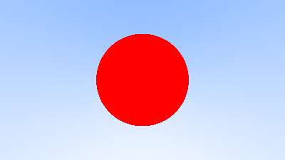
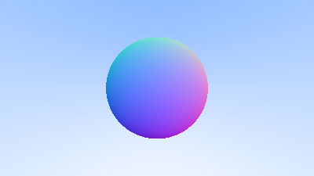
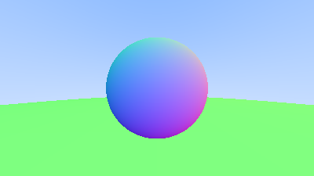

# CPU_RayTracer_PathTracer
Here, I make my First Ray Tracer using no graphics API. A CPU-based ray tracer written in C++ featuring spheres, materials (Glass, metal, dielectric), and camera controls. A simple path tracer built from scratch to learn the basics of computer graphics and physically based rendering.
---

## 🖼️ Progress & Visual Outputs

Here is the step-by-step breakdown of what has been implemented so far.

### : Image Streaming & Camera Ray Setup
* **Logic:**
  * Implemented structural math tracking using the `vec3` utilities for linear algebra operations.
  * Formatted the renderer to map 2D pixel coordinates into a 3D coordinate frame.
  * Used a linear blending (lerp) equation `(1.0 - t) * white + t * blue` based on normalized ray direction heights (`y` axis) to construct a smooth gradient backdrop.
* **Output:**
  

### : Ray-Sphere Intersection Geometry
* **Logic:**
  * Formulated analytical intersections using the geometric sphere equation: `(P(t) - C) · (P(t) - C) = r^2`.
  * Integrated a function to calculate the quadratic equation discriminant `b^2 - 4ac` to determine if a ray vector strikes the object boundary.
* **Output:**
  

### : Hit Record Tracking & Normal Shading
* **Logic:**
  * Abstracted scene surfaces using the `hittable` base class and standard tracking structures (`hit_record`).
  * Extracted the local surface normal vector at the intersection point: `(hit_point - center) / radius`.
  * Translated normalized spatial direction ranges `[-1.0, 1.0]` directly into visible RGB spaces `[0.0, 1.0]` to visually verify correct vector direction handling.
* **Output:**
  

### : Object Containers & Scene Composition
* **Logic:**
  * Implemented the `hittable_list` container utilizing a dynamic vector array (`std::vector<shared_ptr<hittable>>`).
  * Structured the intersection check logic to loops through all objects in the scene, constantly updating the `t_max` boundary to ensure proper depth sorting and occluding.
* **Output:**
  

### : Path Tracing & Diffuse Reflection Loops
* **Logic:**
  * Configured a recursive ray tracking depth loop to sample scattered lighting directions.
  * Calculated true diffuse scattering reflections by generating random bouncing rays originating within a unit hemisphere context relative to the surface hit normal.
  * Multiplied color outputs across successive surface hits to emulate indirect ambient light bouncing, occlusion, and realistic shadows.
* **Output:**
  

---

## 📁 Core Architecture & File Structure

The project code in the `src/` directory is partitioned as follows:

*   **`utility_pch.h`**: The precompiled header wrapper tracking core math standards, constants (like infinity and π), and random number generation utilities.
*   **`vec3.h` / `color.h`**: Primitives for 3D coordinate vector operations (dot products, cross products, unit lengths) and color space formatting.
*   **`ray.h`**: The foundational ray function class mapping linear projection: P(t) = A + tB.
*   **`hittable.h`**: The base interface class creating uniform tracking structures (`hit_record`) for geometric intersections.
*   **`sphere.h`**: The primary analytical shape object containing the quadratic ray-sphere scoring logic.
*   **`hittable_list.h`**: The tracking collector grouping scene elements and finding the closest ray hit point.
*   **`PPM_image.cpp`**: Main entry point organizing scene assembly, launching rendering tasks, and printing data to standard PPM images.

---

## 🛠️ How to Compile and Run

Compile the application through a standard C++ compiler with code optimization enabled:
```bash
g++ -O3 src/PPM_image.cpp -o raytracer
```

Run the compiled executable to stream out the raw visual contents:
```bash
./raytracer > image_output/output.ppm
```
